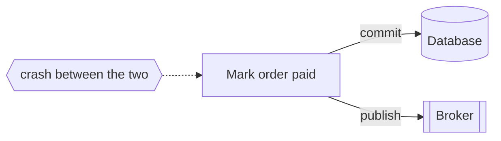
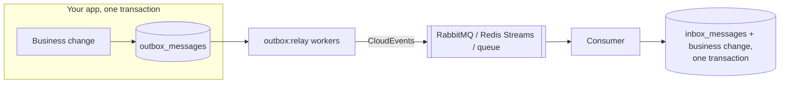
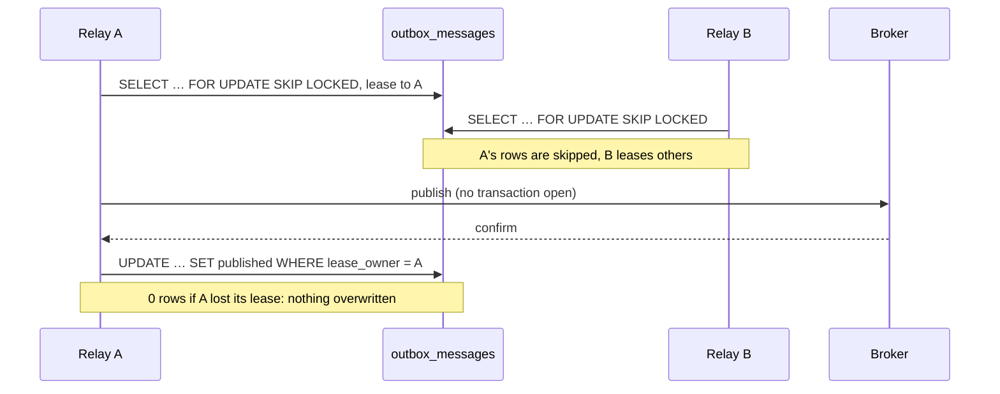

# Laravel Outbox

[](https://github.com/azhimov/laravel-outbox/actions/workflows/ci.yml)
[](https://packagist.org/packages/azhimov/laravel-outbox)
[](https://packagist.org/packages/azhimov/laravel-outbox)
[](LICENSE)

Transactional outbox and inbox for Laravel. An event is written **in the same database transaction** as the business change, a relay delivers it to RabbitMQ, Redis Streams or a Laravel queue **at least once**, and the inbox on the consumer side makes the handler run **once per message**.

What sets it apart: messages of one aggregate are delivered **in commit order even with several relay workers running in parallel**, and that is proven by tests with real concurrent processes on MySQL and PostgreSQL.

## The problem

An order service saves `order.paid` to its database and then publishes it to a broker. If the process dies between the two steps, you get an order nobody hears about, or, if you publish first, an event about an order that was never saved. That's the *dual write* problem.



The transactional outbox fixes it: the event goes into an `outbox_messages` table **in the same transaction** as the order. Either both are committed or neither is. A separate relay then reads the table and publishes.



## Installation

Requires PHP 8.2+ and Laravel 12 or 13, and MySQL 8 or PostgreSQL for production. SQLite works for tests with one relay worker.

```bash
composer require azhimov/laravel-outbox
php artisan vendor:publish --tag=outbox-config
php artisan vendor:publish --tag=outbox-migrations
php artisan migrate
```

Pick a transport (see [Transports](#transports)): RabbitMQ needs `composer require php-amqplib/php-amqplib`; Redis Streams works with phpredis or `predis/predis`.

## Quick start

Publish inside the transaction of the change:

```php
use Azhimov\Outbox\Facades\Outbox;
use Illuminate\Support\Facades\DB;

DB::transaction(function () use ($order) {
    $order->markPaid();

    Outbox::publish(
        topic: 'orders',
        type: 'order.paid',
        payload: ['order_id' => $order->id, 'amount' => $order->amount],
        aggregateId: "order-{$order->id}",   // keeps this order's events in order
        headers: ['tenant' => 'demo'],       // optional
    );
});
```

Outside a transaction, `publish()` throws `NotInTransaction`. That's on purpose: a message published that way would no longer commit together with the change. You can turn the check off with `outbox.strict_transaction` set to `false`.

Run the relay as a long-lived process, for example under Supervisor or as a Kubernetes Deployment:

```bash
php artisan outbox:relay
```
```text
outbox: relaying (pid 4182)
outbox: claimed 3, published 3, failed 0, dead-lettered 0, lease lost 0
```

Run as many relay processes as you like. They share the work without delivering a message twice at the same time, and they keep each aggregate in order.

Event classes can describe themselves:

```php
final class OrderPaid implements \Azhimov\Outbox\Contracts\ShouldBeOutboxed
{
    public function __construct(private Order $order) {}

    public function topic(): string { return 'orders'; }
    public function type(): string { return 'order.paid'; }
    public function payload(): array { return ['order_id' => $this->order->id]; }
    public function aggregateId(): ?string { return "order-{$this->order->id}"; }
}

DB::transaction(fn () => Outbox::publishEvent(new OrderPaid($order)));
```

### On the consumer side: inbox

Delivery is at-least-once, so a consumer can see a message twice. The inbox stores a "processed" mark **in the same transaction** as your handler's changes:

```bash
php artisan vendor:publish --tag=outbox-inbox-migrations && php artisan migrate
```

```php
use Azhimov\Outbox\Facades\Inbox;
use Azhimov\Outbox\Inbox\InboxOutcome;

$outcome = Inbox::handle('billing', $messageId, function () use ($payload) {
    Ledger::credit($payload['account'], $payload['amount']);
});

// InboxOutcome::Processed, or InboxOutcome::AlreadyProcessed (the handler did not run)
```

The scope is consumer + message id, so two services consuming the same message don't interfere. If the handler throws, the mark is rolled back with the change, and the redelivery gets processed. Queue jobs can use the `DeduplicateWithInbox` middleware.

### Testing your app

With `RefreshDatabase` every test runs inside a transaction, so the strict check can't catch a `publish()` you forgot to wrap. Use the fake to assert what would be published:

```php
use Azhimov\Outbox\Facades\Outbox;

Outbox::fake();

$this->postJson('/api/orders/1/pay')->assertOk();

Outbox::assertPublished('order.paid', fn ($m) => $m->aggregateId === 'order-1');
Outbox::assertPublishedTimes('order.paid', 1);
Outbox::assertNotPublished('order.refunded');
// Outbox::assertNothingPublished();
```

The fake validates input the same way the real outbox does.

## How it works / why it's built this way

### Claiming with `SKIP LOCKED` and leases

Each relay worker has a random owner token. Each batch goes through three steps:

1. In a short transaction it runs `SELECT … FOR UPDATE SKIP LOCKED LIMIT n` on due messages. Rows another worker is claiming are skipped, not waited for. The worker then **leases** the rows: `status = processing`, `lease_owner = token`, `lease_until = now + lease_seconds`. Then it commits.
2. It publishes **outside** any transaction, so the broker call doesn't hold database locks.
3. It marks a message `published` with a compare-and-set on `lease_owner`. A worker whose lease expired can't overwrite a message another worker took over.

A worker that dies doesn't keep messages forever: once `lease_until` passes, any worker claims them again. That's exactly why delivery is **at-least-once**, and why the inbox exists.



The test suite starts four relay **processes** on 300 messages and checks that every message is delivered exactly once. With `SKIP LOCKED` removed, the same test sees 420–510 deliveries.

### Order within an aggregate, with parallel workers

Ordering by id isn't enough. Ids are generated before commit, so transaction A can take id 10, transaction B id 11, and B commits first. A relay would then send 11 before 10.

Instead, `publish()` with an `aggregateId` increments a counter row in `outbox_aggregates` with one upsert, in your transaction:

- PostgreSQL, SQLite: `INSERT … ON CONFLICT … DO UPDATE … RETURNING`
- MySQL: `ON DUPLICATE KEY UPDATE last_seq = LAST_INSERT_ID(last_seq + 1)`

The upsert locks that row until commit. A second writer of the same aggregate waits, so the `aggregate_seq` values are handed out **in commit order**.

The relay claims a message only if every earlier message of its aggregate is already `published`. That gives three properties:

- each aggregate has at most one message in flight;
- different aggregates are spread over all workers;
- a message that ends up `failed` blocks **only its own aggregate** (event `AggregateBlocked`) until you run `outbox:retry`. Skipping it would deliver `order.shipped` before `order.paid`.

The suite tests this with four relay processes, 20 aggregates × 15 messages. With ordering disabled, the same test reports aggregates delivered out of order.

Messages without `aggregateId` have no order and no counter. Set `outbox.ordering` to `none` to turn ordering off everywhere.

### Retries and the dead letter

A failed delivery comes back after `min(base × multiplier^(n−1), max) ± jitter`. Defaults: 1 s, ×2, 5 min, ±20%. After `max_attempts` (default 10) the message becomes `failed` and fires `MessageFailed`; alert on it and fix the cause.

The relay also dead-letters a message whose lease expired on its last attempt, because the worker died while delivering. Claiming it again could take the next worker down the same way.

### Message format: CloudEvents 1.0, binary mode

The body is your payload JSON **byte for byte**. It is stored as text, not as a `json` column, because MySQL reorders keys and `jsonb` reformats them, and consumers that hash or sign a body need the exact bytes.

The attributes travel beside the body:

| Attribute | Value |
|---|---|
| `specversion` | `1.0` |
| `id` | message id (UUIDv7) |
| `type` | message type, e.g. `order.paid` |
| `source` | `outbox.source`, default `app.name` |
| `subject` | `aggregateId` (omitted when null) |
| `time` | creation time, RFC 3339 with milliseconds, UTC |
| `datacontenttype` | `application/json` |

Spec: [CloudEvents 1.0.2](https://github.com/cloudevents/spec/blob/v1.0.2/cloudevents/spec.md). Header names starting with `ce_`, and the names `data` and `content-type`, are reserved.

## Transports

| Transport | `OUTBOX_TRANSPORT` | Where messages go | Success means |
|---|---|---|---|
| RabbitMQ | `rabbitmq` | exchange = topic, routing key = type; persistent; attributes as `ce_*` headers, plus `message_id`, `type`, `timestamp` and `app_id` properties | publisher confirm received **and** routed to a queue: an unroutable message is a failure |
| Redis Streams | `redis` | `XADD` to `stream_prefix + topic`; fields `ce_*`, `content-type`, your headers, then `data` | entry id returned |
| Laravel queue | `queue` | a `DeliverOutboxMessage` job; on the consumer side `outbox.transports.queue.handlers` maps `type => handler` | job pushed |
| Log | `log` (default) | a log channel | written |
| Null | `null` | nowhere | always |

For the queue transport, an unknown `type` fires `UnhandledOutboxMessage` and logs a warning instead of failing the job. Set `deduplicate` to `true` to run deliveries through the inbox.

To add your own transport, implement `Transport::publish(OutboxMessage $m): void`: return when the broker has accepted the message, throw otherwise. Register it with `app(TransportManager::class)->extend('sqs', fn ($app) => new SqsTransport(...))`.

CI tests RabbitMQ and Redis Streams against real servers. Redis Streams runs with both phpredis and predis.

## Commands

| Command | Does |
|---|---|
| `outbox:relay [--once] [--batch=] [--sleep=] [--max-batches=]` | delivers messages. Loop mode exits after the batch in hand on SIGTERM / SIGINT; `--once` runs one batch, for cron and tests |
| `outbox:retry {id}` / `outbox:retry --all-failed` | sends failed messages again: attempts reset, `last_error` kept |
| `outbox:prune --published-older-than=7d [--chunk=1000]` | deletes old published messages; pending and failed ones are kept, and so are the aggregate counters |
| `inbox:prune --older-than=30d` | deletes old inbox marks. Keep them longer than any redelivery window |

## Configuration

Everything lives in `config/outbox.php`; the main keys also read env variables.

| Key | Env | Default | Meaning |
|---|---|---|---|
| `connection` | `OUTBOX_CONNECTION` | default connection | must be the connection of your business transaction |
| `strict_transaction` | `OUTBOX_STRICT_TRANSACTION` | `true` | throw on `publish()` outside a transaction |
| `transport` | `OUTBOX_TRANSPORT` | `log` | `rabbitmq`, `redis`, `queue`, `log`, `null` or a custom name |
| `source` | `OUTBOX_SOURCE` | `app.name` | CloudEvents `source` |
| `ordering` | `OUTBOX_ORDERING` | `aggregate` | `none` disables per-aggregate order |
| `relay.batch_size` | `OUTBOX_RELAY_BATCH_SIZE` | `100` | messages per claim |
| `relay.sleep_ms` | `OUTBOX_RELAY_SLEEP_MS` | `1000` | wait when the outbox is empty |
| `relay.lease_seconds` | `OUTBOX_RELAY_LEASE_SECONDS` | `30` | must exceed your slowest broker call, timeouts included |
| `relay.max_attempts` | `OUTBOX_RELAY_MAX_ATTEMPTS` | `10` | then `failed` |
| `relay.backoff.*` | — | 1000 ms, ×2, 300000 ms, 0.2 | retry delays |
| `inbox.connection` / `inbox.consumer` | `OUTBOX_INBOX_CONNECTION` / `OUTBOX_INBOX_CONSUMER` | outbox connection / none | inbox settings |
| `transports.*` | `OUTBOX_RABBITMQ_*`, `OUTBOX_REDIS_*`, `OUTBOX_QUEUE*` | — | per-transport settings |

## Events

| Event | When |
|---|---|
| `MessageStored` | after the business transaction **commits** (`ShouldDispatchAfterCommit`), never on rollback |
| `MessagePublished` | the broker accepted the message |
| `MessagePublishFailed` | every failed attempt: error, attempt number, `retryAt` (null on the last one) |
| `MessageFailed` | moved to the dead letter: **alert** |
| `AggregateBlocked` | a failed message holds back its aggregate: **alert** |
| `LeaseLost` | delivered after another worker took over: a duplicate is possible; often means `lease_seconds` is too short |
| `InboxDuplicateSkipped` | a consumer skipped a message it had already processed |
| `UnhandledOutboxMessage` | the queue transport received a type with no handler |

## Compared with alternatives

Checked against README and source on 11.11.2026; corrections are welcome.

| | this package | [Ecotone](https://github.com/ecotoneframework/ecotone-dev) | [ianfoxdev/outbox](https://github.com/IanFoxDev/outbox) | [mykholy/laravel-flowguard](https://github.com/mykholy/laravel-flowguard) | [EventSauce outbox](https://github.com/EventSaucePHP/MessageOutboxForIlluminate) |
|---|---|---|---|---|---|
| What it is | Laravel package | CQRS / messaging framework | PHP writer + relay in Go | operation claims + outbox lease store | outbox for EventSauce |
| Parallel relay workers | yes, `SKIP LOCKED` + lease + CAS | yes, `SKIP LOCKED` | one active relay (advisory lock) | yes, `SKIP LOCKED` + lease | one relay |
| Order per aggregate | yes, **with parallel workers** | event-sourced streams, Kafka keys | yes, with one relay | no | global FIFO, one relay |
| Inbox in the handler's transaction | yes | yes | yes (separate package) | webhook inbox | no |
| Real brokers in CI | RabbitMQ, Redis Streams | Kafka, RabbitMQ, SQS, Redis | Kafka, RabbitMQ | none | none |
| Transports | RabbitMQ, Redis Streams, Laravel queue | many | Kafka, RabbitMQ | bring your own | EventSauce consumers |

If you already use Ecotone, use its outbox. If one relay is enough, `ianfoxdev/outbox` is a well-engineered choice with a fast Go relay. This package is for Laravel apps that want outbox, relay and inbox in one Composer package, with ordering that survives horizontal scaling.

## Limitations

- **At-least-once, not exactly-once.** A worker can die after the broker accepted a message and before it is marked published; another worker then sends it again. Make consumers idempotent; that's what the inbox is for.
- **The outbox must live on the business connection.** `publish()` checks the transaction on `outbox.connection`. A transaction on another connection doesn't count.
- **Several aggregates in one transaction can deadlock.** Each aggregate's counter row is locked until commit. If two transactions touch aggregates X and Y in opposite order, the database aborts one of them. Publish aggregates in a stable order, for example sorted by id.
- **A failed message blocks its aggregate** until `outbox:retry`. That's the price of strict order. Alert on `AggregateBlocked`, or turn ordering off.
- **One message per aggregate per batch.** Throughput per aggregate is one message per relay round trip, which is plenty for most aggregates and wrong for a single very hot one.
- **MySQL claims lock briefly.** Under REPEATABLE READ, the claim query also locks rows it scanned and filtered out until its transaction ends, a few milliseconds. Other workers skip them, so a worker may see an empty batch while work remains. That costs latency, not correctness.
- **SQLite is for tests only.** There are no row locks, so run one relay worker.
- **`RefreshDatabase` hides a missing transaction.** Use `Outbox::fake()` in application tests.
- **No Kafka yet**; it's planned for 0.2.

## Roadmap

- 0.2: Kafka transport (ext-rdkafka, key = aggregate id).
- 0.2: a `docker compose` demo: MySQL + RabbitMQ + relay + a consumer with the inbox.
- Prometheus metrics for the relay: lag, attempts, dead letters.

## Testing

```bash
composer check          # Pint, Larastan (max), Pest on SQLite
docker compose up -d    # MySQL, PostgreSQL, RabbitMQ, Redis for the integration suites
composer test:mysql
composer test:pgsql
```

The concurrency tests start separate PHP processes against MySQL or PostgreSQL. The broker tests need RabbitMQ and Redis. CI runs all of them, plus PHP 8.2–8.5 × Laravel 12–13 and coverage of at least 90%.

## Changelog

See [CHANGELOG.md](CHANGELOG.md).

## License

MIT. See [LICENSE](LICENSE).
